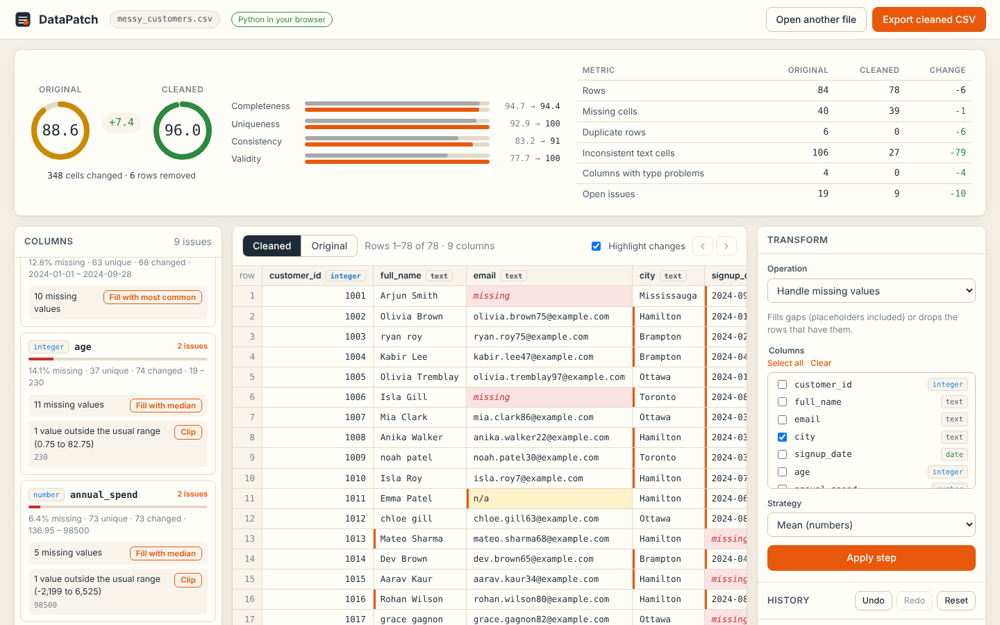

# DataPatch


A visual workbench for cleaning CSV files before they go into analysis or a model.

Upload a CSV, see what's wrong with each column, fix it one step at a time, undo anything you
don't like, and compare the quality score of the original and cleaned data before you export.
Save the steps as a recipe and run them again on next month's file, in the browser or from the
command line.

**Live demo: <https://your-username.github.io/datapatch/>** (replace `your-username` once you
have deployed it). The demo runs the real Python code in your browser, so your data never
leaves your device.



## Why

Real-world CSVs are rarely ready to use. Names have stray spaces, `Toronto`, `toronto` and
` TORONTO` are counted as three cities, numbers arrive as `"$1,250.00"`, dates come in three
formats and someone typed `N/A` into half the email column. Fixing that in a notebook works, but
it's slow to see what changed and easy to lose track of what you did. DataPatch puts the data,
the problems and the fixes on one screen, and keeps a record of every step.

## Features

**Inspect**
- Upload `.csv`, `.tsv` or `.txt` files; the encoding and delimiter are detected. Files with
  rows that don't match the header are reported with the offending line instead of being
  silently misread.
- Page through the data and switch between the **Original** and **Cleaned** versions.
- A profile for every column: type, missing values, unique values, range, and the problems found:
  - missing values and placeholder strings (`N/A`, `-`, `unknown`, ...)
  - leading, trailing or doubled spaces
  - values that differ only by case or spacing (`basic` / `Basic` / `BASIC`)
  - numbers, dates or yes/no flags stored as text
  - outliers (outside 1.5x IQR) and one-off values that might be typos

**Clean**
- One-click fixes next to each problem.
- A transform panel with 11 operations: trim whitespace, standardize categories (automatic or
  with your own mapping), change case, mark placeholders as missing, handle missing values
  (mean, median, most common, a fixed value, forward/back fill, or drop rows), remove duplicates,
  convert types, replace values, handle outliers, rename columns and drop columns.
- Undo, redo and reset, with `Ctrl+Z` / `Ctrl+Shift+Z`. Reset keeps the steps redoable.

**Compare and export**
- Quality scores for the original and cleaned data side by side, with the four components and
  the counts behind them.
- Changed cells are marked in the cleaned view; hover one to see its original value. The row
  column shows each row's number in the original file, so removed rows are easy to spot.
- Export the cleaned CSV.
- Save the steps as a **recipe** (JSON) and apply it to another file, here or from the
  command line.

## Quick start

The quickest way to try DataPatch is the live demo: nothing to install. To run it on your own
machine you need Python 3.10 or newer.

```bash
git clone https://github.com/<your-username>/datapatch.git
cd datapatch

python -m venv .venv
source .venv/bin/activate        # Windows: .venv\Scripts\activate

pip install -r requirements.txt
python app.py
```

Open <http://127.0.0.1:5000>. Set the `PORT` environment variable to use another port, or
`FLASK_DEBUG=1` for auto-reload while developing.

## Live demo walkthrough

1. Click **Try the messy sample**. It loads `sample_data/messy_customers.csv`: 84 customer rows
   with 6 duplicates, stray spaces, mixed-case cities and plans, placeholder emails, dates in
   three formats, ages and amounts stored as text, and an age of 230. It starts at a score of
   about 88.6.
2. In **Transform**, choose *Remove duplicate rows* and apply it. Six rows go, and the row
   column now skips their numbers.
3. Apply *Trim whitespace* with no columns selected to tidy every text column.
4. Use the **Merge variants** buttons on `city` and `plan`, then the **Convert** buttons on
   `signup_date`, `age`, `annual_spend` and `active`. Changed cells get an orange edge; hover
   one to see what it was.
5. Click the `city` header, pick *Replace a value* and change `Torontoo` to `Toronto`.
6. Clip the outlier in `age` and fill the remaining gaps with the median. The cleaned score
   climbs to about 98.6 next to the unchanged original.
7. Flip between **Cleaned** and **Original**, undo a step or two, then **Export cleaned CSV**
   and **Save recipe**.

## How the quality score works

The score (0 to 100) is a weighted blend of four ratios:

| Component | Weight | What it measures |
| --- | --- | --- |
| Completeness | 40% | Share of cells that aren't missing. Placeholder strings count as missing. |
| Uniqueness | 20% | Share of rows that aren't exact duplicates of an earlier row. |
| Consistency | 20% | Share of text cells without extra spaces or case/spacing variants. |
| Validity | 20% | Per column: 1.0 if the stored type fits the values. Text columns that are really numbers, dates or yes/no flags get at most half credit until converted. |

Outliers and rare values are reported but don't change the score, because they are often real.

## API

These are the routes `index.html` calls. With `python app.py` they're HTTP endpoints; on GitHub
Pages the page sends the same requests to `DataPatchAPI.dispatch` inside the browser. Either
way the page only receives one page of rows at a time plus the column profiles.

| Method | Path | Purpose |
| --- | --- | --- |
| `POST` | `/api/upload` | Multipart upload (`file`). Creates a session and returns its state. |
| `POST` | `/api/sample` | Opens the bundled messy sample. |
| `GET` | `/api/workspaces/<id>` | Current state. Query: `view=cleaned\|original`, `offset`, `limit` (max 500). |
| `POST` | `/api/workspaces/<id>/steps` | Apply a step, e.g. `{"op": "trim_whitespace", "params": {"columns": ["name"]}}`. |
| `POST` | `/api/workspaces/<id>/undo` | Undo the last step. |
| `POST` | `/api/workspaces/<id>/redo` | Redo the last undone step. |
| `POST` | `/api/workspaces/<id>/reset` | Back to the original (the steps stay redoable). |
| `GET` | `/api/workspaces/<id>/export` | Download the cleaned CSV. |
| `GET` | `/api/workspaces/<id>/recipe` | Download the steps as a recipe. |
| `POST` | `/api/workspaces/<id>/recipe` | Apply a recipe (JSON body). All or nothing. |
| `GET` | `/api/health` | Health check. |

Errors come back as `{"error": "..."}` with a 4xx status. The state object includes the page of
rows, `row_numbers` (positions in the original file), `changed_cells` (`[row, column, original
value]` for the page), a `changes` summary, the column profiles, both scores and the history.

<details>
<summary>Operations and their parameters</summary>

| `op` | Parameters |
| --- | --- |
| `trim_whitespace` | `columns` (optional, default all text columns) |
| `change_case` | `columns`, `mode`: `lower` \| `upper` \| `title` \| `sentence` |
| `standardize_categories` | `column`, `mode`: `auto` \| `mapping`, `mapping`: `{"old": "new"}` (an empty new value means missing) |
| `mark_missing` | `columns` (optional), `markers` (optional list; numbers such as `-999` work on numeric columns) |
| `fill_missing` | `columns`, `strategy`: `mean` \| `median` \| `mode` \| `constant` \| `ffill` \| `bfill` \| `drop_rows`, `value` (for `constant`) |
| `remove_duplicates` | `columns` (optional subset), `keep`: `first` \| `last` \| `none` |
| `convert_type` | `columns`, `target`: `number` \| `integer` \| `date` \| `boolean` \| `text`, `dayfirst` (dates) |
| `replace_values` | `columns`, `find`, `replace` (empty means missing) |
| `handle_outliers` | `column`, `method`: `clip` \| `missing` \| `remove`, `factor` (IQR multiplier, default 1.5) |
| `rename_column` | `column`, `new_name` |
| `drop_columns` | `columns` |

</details>

## Limitations

- With the local server, sessions live in its memory and expire after three hours of inactivity.
  In the browser, a session lives in the page and ends when you reload or close it, so export
  your CSV and save your recipe before leaving. See [SECURITY.md](SECURITY.md).
- The in-browser engine needs a browser that supports module Web Workers and WebAssembly (current
  Chrome, Edge, Firefox and Safari) and access to `cdn.jsdelivr.net` on first load.
- Uploads are capped at 25 MB. Column profiles are cached, so a step only re-profiles the columns
  it changed; on a 20 MB file a typical step takes around a second.
- Ambiguous dates such as `03/07/2024` are read month-first unless you tick *day-first* when
  converting.
- Values that can't be converted to the target type become missing; the step's message says how
  many.

## License and author

Swayam Shakya, Released under the MIT License. See [LICENSE](LICENSE).

